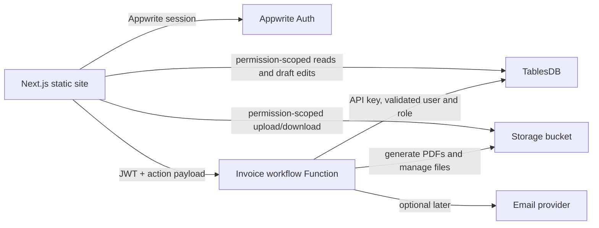
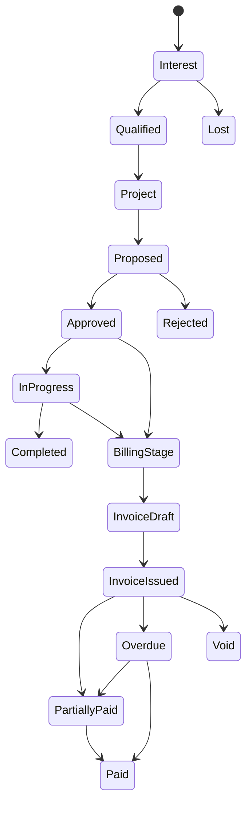

# Invoice system design

## 1. Product boundary

This is a private, single-business application for moving a customer from an
initial interest through project delivery and staged invoicing.

The first release includes:

- customer companies and multiple contacts per company;
- a separate, searchable contact directory;
- interests/opportunities and a chronological contact/follow-up log;
- projects created from an approved interest or directly;
- proposals, email records, notes, and project files;
- quotations with versioned line items and approval state;
- configurable project billing stages;
- one or more invoices per project, optionally linked to a billing stage;
- invoice delivery, due, overdue, paid, void, and write-off tracking; and
- a complete audit history for commercial records.

Public signup, customer portal access, accounting-ledger features, automatic
bank reconciliation, and direct mailbox synchronization are deliberately out
of the first release.

## 2. Technical shape

Use the proven Offgrid Tracker layout, but omit the mobile app, firmware, MQTT,
Devices API, and time-series components.



### Repository components

- `site/`: Next.js 16 App Router, React, TypeScript, static export, Appwrite Web
  SDK, and an authenticated application shell.
- `function/`: Node 24 Appwrite Function using `node-appwrite`. It owns actions
  that must be atomic or privileged.
- `infra/`: Appwrite CLI installer based on the reference repository's
  `ensure(...)` pattern, so deployment is safe to rerun.
- `appwrite.config.json`: stable IDs for the Site, Function, TablesDB database,
  tables, indexes, and storage bucket.

The API key is available only to `infra/` during deployment and to the Function
runtime. It is never exposed through Site variables or browser code.

## 3. Navigation and screens

### Dashboard

- open interests and follow-ups due today;
- active projects awaiting action;
- draft/sent quotations awaiting approval;
- invoice totals grouped by draft, outstanding, overdue, and paid;
- upcoming billing stages; and
- recent activity.

### Customers

- `Companies`: table/card view, filters, owner, status, tags, and quick add;
- `Company detail`: overview, contacts, interests, projects, invoices, files,
  and one combined activity timeline; and
- `Contacts`: global directory with search by name, company, email, phone,
  title, and tags.

### Sales

- `Interests`: list and optional kanban by pipeline status;
- `Interest detail`: description, value estimate, probability, owner, next
  action, contact people, and activity log; and
- `Follow-ups`: assigned-to-me and overdue views.

### Projects

- project list with customer, owner, status, value, and invoice progress;
- project overview with participants and delivery dates;
- proposals and proposal versions;
- recorded emails and attachments;
- quotation versions;
- billing stages; and
- invoice/payment timeline.

### Finance

- quotations;
- invoices with status, issue date, due date, amount, paid, and balance;
- aging buckets: current, 1–30, 31–60, 61–90, and 90+ days;
- payment entry and allocation; and
- document/settings administration.

### Administration

- business identity, address, logo, tax identifiers, bank/payment instructions;
- default currency, tax rates, payment terms, numbering prefixes, and document
  footer text;
- staff member list and roles; and
- audit log.

## 4. Business workflow



Recommended states:

| Record | States |
| --- | --- |
| Company | `prospect`, `active`, `inactive`, `archived` |
| Interest | `new`, `contacted`, `qualified`, `proposal`, `won`, `lost`, `on_hold` |
| Project | `draft`, `proposed`, `approved`, `in_progress`, `on_hold`, `completed`, `cancelled` |
| Proposal | `draft`, `sent`, `accepted`, `rejected`, `expired`, `superseded` |
| Quotation | `draft`, `issued`, `accepted`, `rejected`, `expired`, `cancelled` |
| Billing stage | `planned`, `ready`, `partially_invoiced`, `fully_invoiced`, `cancelled` |
| Invoice | `draft`, `issued`, `partially_paid`, `paid`, `overdue`, `void`, `written_off` |

The Function validates every transition. The site must not be able to change an
issued quotation/invoice back into a draft or alter its financial snapshot.

## 5. Data model

Use a single TablesDB database with ID `invoice-system`. Use stable string IDs
for references rather than Appwrite relationship columns; this keeps queries,
imports, and infrastructure reconciliation predictable.

All money is stored as integer minor units (`125050` means 1,250.50 for a
two-decimal currency). Every commercial record stores its currency. Issued
documents snapshot customer identity, address, tax, terms, line descriptions,
and totals so later customer edits never rewrite history.

### Core CRM tables

#### `companies`

`name`, `legalName`, `registrationNumber`, `taxNumber`, `website`, `industry`,
`status`, `ownerUserId`, `billingEmail`, billing-address fields, `currency`,
`paymentTermsDays`, `notes`, `tags[]`, `createdBy`, `updatedBy`.

The same table holds exactly one internal issuer row marked `isOwnCompany`.
That row is excluded from customer screens and stores the legal identity,
contact details, address, tax and VAT numbers, base currency, default terms, and invoice
footer/payment instructions copied into quotation and invoice snapshots.

Indexes: name search/full-text, `status`, `ownerUserId`, `taxNumber` unique when
the deployment supports sparse uniqueness, and updated time.

#### `contacts`

`companyId`, `firstName`, `lastName`, `displayName`, `jobTitle`, `department`,
`email`, `phone`, `mobile`, `isPrimary`, `status`, `notes`, `tags[]`, `createdBy`,
`updatedBy`.

Indexes: `companyId`, name search/full-text, email, phone, and `status`.

#### `interests`

`companyId`, `primaryContactId`, `title`, `description`, `source`, `status`,
`ownerUserId`, `estimatedValueMinor`, `currency`, `probability`, `nextActionAt`,
`expectedCloseDate`, `lostReason`, `convertedProjectId`, `createdBy`, `updatedBy`.

Indexes: `companyId`, `primaryContactId`, `ownerUserId + status`, `status +
nextActionAt`, and `expectedCloseDate`.

#### `activities`

A shared immutable timeline for companies, contacts, interests, and projects.

`entityType`, `entityId`, `companyId`, `contactId`, `activityType`, `direction`,
`subject`, `body`, `occurredAt`, `nextActionAt`, `assignedToUserId`, `outcome`,
`createdBy`.

`activityType` is one of `note`, `call`, `meeting`, `email`, `follow_up`, or
`status_change`. Email-specific delivery metadata belongs in `emails`.

Indexes: `entityType + entityId + occurredAt`, `companyId + occurredAt`, and
`assignedToUserId + nextActionAt`.

### Project and communication tables

#### `projects`

`companyId`, `interestId`, `primaryContactId`, `projectNumber`, `name`,
`description`, `status`, `ownerUserId`, `startDate`, `targetEndDate`,
`approvedAt`, `completedAt`, `currency`, `contractValueMinor`, `createdBy`,
`updatedBy`.

Indexes: unique `projectNumber`, `companyId`, `interestId`, and `ownerUserId +
status`.

#### `project_contacts`

`projectId`, `contactId`, `role`, `isPrimary`, `createdBy`.

Indexes: unique `projectId + contactId`, plus `contactId`.

#### `proposals`

`projectId`, `proposalNumber`, `version`, `title`, `status`, `summary`,
`validUntil`, `fileId`, `sentAt`, `respondedAt`, `createdBy`.

Indexes: `projectId + version`, unique `proposalNumber + version`, and `status`.

#### `emails`

This table records relevant correspondence; it is not a mail server.

`companyId`, `projectId`, `interestId`, `contactIds[]`, `direction`, `from`,
`to[]`, `cc[]`, `subject`, `bodyText`, `messageDate`, `messageId`, `threadId`,
`status`, `createdBy`.

Indexes: `projectId + messageDate`, `interestId + messageDate`, `companyId +
messageDate`, and `messageId`.

### Commercial tables

#### `quotations`

`projectId`, `companyId`, `quotationNumber`, `version`, `status`, `issueDate`,
`validUntil`, `currency`, `customerSnapshotJson`, `termsSnapshot`,
`subtotalMinor`, `discountMinor`, `taxMinor`, `totalMinor`, `fileId`, `issuedAt`,
`acceptedAt`, `createdBy`.

Indexes: unique `quotationNumber + version`, `projectId + version`, and status.

#### `quotation_items`

`quotationId`, `position`, `description`, `quantityScaled`, `quantityScale`,
`unit`, `unitPriceMinor`, `discountBasisPoints`, `taxRateBasisPoints`,
`lineSubtotalMinor`, `lineTaxMinor`, `lineTotalMinor`.

Indexes: unique `quotationId + position`.

`quantityScaled / quantityScale` avoids floating-point quantities. For
example, quantity 1.5 is stored as `1500 / 1000`.

#### `billing_stages`

`projectId`, `name`, `position`, `description`, `triggerType`, `triggerDate`,
`percentageBasisPoints`, `plannedAmountMinor`, `invoicedAmountMinor`, `status`,
`createdBy`, `updatedBy`.

A project may use percentages, fixed amounts, or a mix. The Function rejects a
stage plan whose fixed/percentage totals exceed the approved project value
unless an administrator explicitly records a variation.

Indexes: unique `projectId + position`, and `projectId + status`.

#### `invoices`

`projectId`, `companyId`, `billingStageId` (optional), `invoiceNumber`,
`status`, `issueDate`, `dueDate`, `currency`, `customerSnapshotJson`,
`paymentInstructionsSnapshot`, `subtotalMinor`, `discountMinor`, `taxMinor`,
`totalMinor`, `paidMinor`, `balanceMinor`, `fileId`, `issuedAt`, `paidAt`,
`voidedAt`, `createdBy`.

Indexes: unique `invoiceNumber`, `projectId + issueDate`, `companyId + status`,
`status + dueDate`, and `billingStageId`.

#### `invoice_items`

Same monetary fields as `quotation_items`, plus optional `billingStageId` and
`quotationItemId` for traceability.

Indexes: unique `invoiceId + position`, `billingStageId`.

#### `payments`

`companyId`, `paymentDate`, `currency`, `amountMinor`, `method`, `reference`,
`notes`, `receiptFileId`, `createdBy`.

Indexes: `companyId + paymentDate`, `reference`.

#### `payment_allocations`

`paymentId`, `invoiceId`, `amountMinor`, `createdBy`.

Indexes: unique `paymentId + invoiceId`, plus `invoiceId`.

### Supporting tables

#### `files`

Application metadata for each Storage file: `bucketId`, `fileId`, `folder`,
`entityType`, `entityId`, `category`, `originalName`, `mimeType`, `sizeBytes`,
`description`, `uploadedBy`, `uploadedAt`.

Indexes: unique `fileId`, `entityType + entityId`, and `category`.

#### System ledger (`number-sequences` resource ID)

The EdgeZ shared TablesDB tier supports seven tables per database, so internal
number counters and audit entries share one Function-owned ledger table. Its
stable resource ID remains `number-sequences` so a partially completed initial
deployment can be upgraded in place. Sequence rows generate numbers such as
`PRJ-2026-0001`, `QUO-2026-0001`, and `INV-2026-0001`.

#### `settings`

Keyed business settings and document defaults. Only administrators write it.
Sensitive provider credentials remain Function secrets, never table values.

Audit rows in the same ledger are append-only. To remain comfortably below the
shared tier's column limit, the table has only the four original sequence
columns plus one `payload` column. Audit actor, action, entity, request ID, and
before/after snapshots are encoded in that payload. It is an Appwrite `text`
column, so it is stored off-row and does not consume the database engine's
fixed inline row-width budget. The audit request ID is also the row ID, which
makes retries idempotent; Appwrite's system `$createdAt` supplies the timestamp.
The Function writes ledger rows; administrators can read them.

## 6. Files and document storage

Create one encrypted bucket, `invoice-files`, with file security enabled and no
public access. Allow PDFs, common office formats, images, plain text, and email
files (`.eml`); set an explicit size limit, initially 25 MB per file.

Use virtual folder paths for organization:

```text
companies/{companyId}/general/
interests/{interestId}/attachments/
projects/{projectId}/proposals/
projects/{projectId}/emails/
projects/{projectId}/quotations/
projects/{projectId}/invoices/
projects/{projectId}/receipts/
```

Folders are organizational only; permissions live on each file. The `files`
table is the source of entity/category metadata and supports efficient listing
without scanning the entire bucket.

Generated quotation and invoice PDFs are immutable. A correction creates a new
quotation version, credit/void action, or replacement invoice according to the
chosen finance policy; it never overwrites an issued file.

## 7. Authentication and authorization

### Login

- Enable email/password and JWT.
- Disable anonymous, magic-link, public email-OTP login, phone login, and OAuth.
- Do not expose an account creation screen.
- Administrators create users with the Appwrite Users API/Console.
- Mark the managed user's email verified, then require email as the MFA factor.
- Login is password first, followed by an Appwrite MFA email challenge and its
  six-digit OTP.
- Generate recovery codes during MFA enrollment and require the user to store
  them before continuing.

Important: Appwrite email OTP is a passwordless primary login, while an email
MFA challenge is the correct second step after password login. These must not
be implemented as interchangeable login buttons.

### MFA onboarding

Appwrite MFA is enabled per user. A newly backend-created account therefore
needs a controlled first-login enrollment flow. The user must have no business
data access until email verification, MFA enablement, and staff-team membership
are complete. The safest operational sequence is:

1. Admin creates the user and verifies the managed email.
2. User signs in with the temporary password, saves recovery codes, and enables
   email MFA.
3. Admin confirms `mfa: true`, adds the user to the `invoice-staff` team, and
   forces a password change if a temporary password was used.
4. Every later session performs password + email MFA before Appwrite authorizes
   application requests.

This avoids relying on a UI-only MFA gate, which a direct API client could
bypass before MFA was enabled.

### Roles

Use one stable team, `invoice-staff`, with membership roles:

| Role | Access |
| --- | --- |
| `admin` | all data, settings, users/memberships, void/write-off, audit |
| `sales` | companies, contacts, interests, activities, projects, proposals, quotations |
| `finance` | read CRM/projects; manage quotations, invoices, payments, and finance files |
| `viewer` | read-only business records and permitted files |

Table permissions grant read access to the team. Draft creation/update can be
granted to the appropriate team roles. Issued financial records, number
sequences, payment allocations, and audit logs are mutated only through the
Function. Use row security where records need owner-level restrictions later;
the initial single-business release can use role-scoped table permissions.

## 8. Function API and invariants

Prefer one Function deployment with a small action router. Each request carries
an Appwrite JWT. The Function validates the user, confirmed team membership,
role, payload schema, current record state, and idempotency key.

Initial actions:

| Action | Responsibility |
| --- | --- |
| `interest.convert` | Create project once and link the won interest |
| `project.approve` | Freeze the approved commercial basis |
| `quotation.issue` | Allocate number, snapshot data, calculate totals, generate PDF |
| `quotation.respond` | Accept/reject with timestamp and audit entry |
| `invoice.issue` | Allocate number, validate stage balance, snapshot, calculate, generate PDF |
| `invoice.void` | Enforce role/reason rules and preserve audit history |
| `payment.record` | Create payment and allocations, update invoice balances/status |
| `invoice.refresh-status` | Mark eligible issued balances overdue |
| `file.finalize` | Validate upload and create the `files` metadata row |

Financial calculations happen on the server. The Function recomputes every
subtotal, discount, tax, total, paid amount, balance, and billing-stage total;
it never trusts totals submitted by the browser.

Use an idempotency key table or an immutable request ID on issue/payment actions
so retries cannot produce duplicate document numbers or allocations.

An hourly scheduled execution may update overdue invoice status. Sending email
and mailbox synchronization remain adapters for a later phase; the core model
does not depend on a particular email vendor.

## 9. UX details that prevent data problems

- Company and contact deletion is archive-only after references exist.
- Warn about likely duplicate companies by normalized name/tax number and
  contacts by normalized email/phone.
- Show one chronological timeline across notes, calls, emails, status changes,
  issued documents, and payments.
- Autosave only ordinary drafts; issuing/approving/voiding requires a clear
  confirmation dialog and optional reason.
- Show currency on every amount and prevent mixed-currency totals.
- Display the source quotation and billing stage on each invoice.
- Never infer payment merely from an invoice being sent or marked complete.
- Keep server timestamps and actor IDs for all state changes.

## 10. Suggested MVP cuts

### Phase 1 — secure foundation and CRM

Build authentication/MFA, staff roles, app shell, companies, contacts, global
search, interests, activities, follow-ups, storage upload, and audit logging.

### Phase 2 — projects and commercial documents

Add project conversion, participants, proposals, email records, quotations,
line items, document numbering, PDFs, and acceptance tracking.

### Phase 3 — staged invoicing

Add billing-stage editor, invoice issue flow, multiple invoices per project,
payments, allocations, automatic overdue status, aging dashboard, and exports.

### Phase 4 — integrations

Add outbound email, mailbox capture, payment-provider/bank imports, reminders,
and accounting export only after the internal workflow is stable.

## 11. Decisions to confirm before implementation

The architecture above makes conservative defaults, but these product choices
affect document and finance rules:

1. Base country and tax regime, including whether tax is per line and whether
   credit notes are legally required instead of void/replacement invoices.
2. Supported currencies and whether a project can contain more than one.
3. Invoice numbering format and whether numbers reset annually.
4. Whether a billing stage may produce several invoices (recommended: yes) and
   whether one invoice may cover several stages (recommended: yes via items).
5. Whether proposals/emails are only stored or also sent/synchronized in the
   first release.
6. Whether salespeople may see all customers or only records they own.

